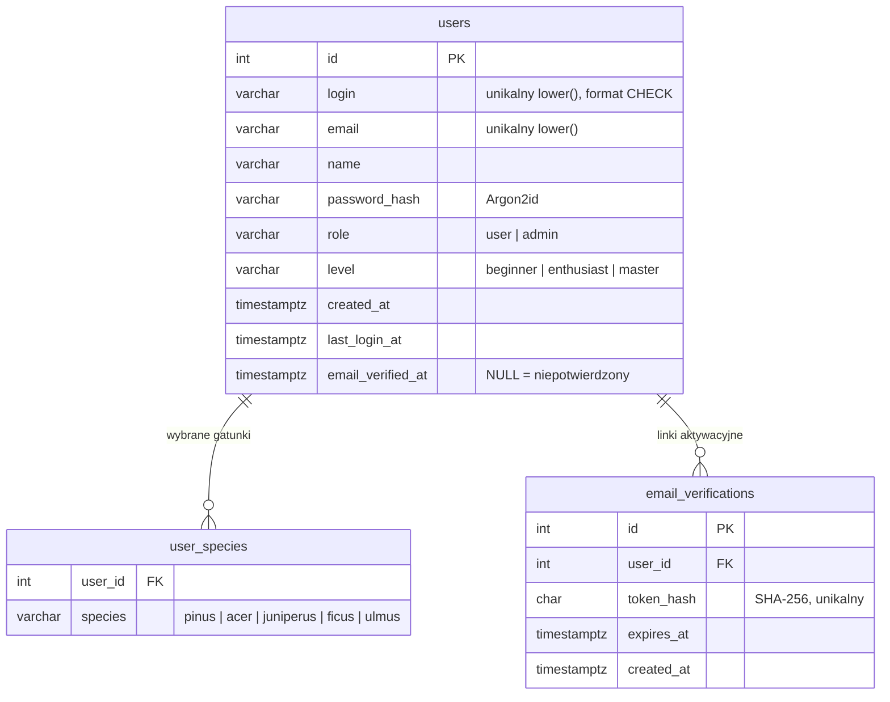

# Specyfikacja systemu KOMOREBI

## 1. Cel i zakres

KOMOREBI to edukacyjna aplikacja webowa dla opiekunów drzewek bonsai. Pozwala prowadzić kolekcję (stan, zabiegi, zdjęcia, dziennik), planować zabiegi w harmonogramie, sprawdzać zasady formowania w Studiu i reagować na objawy w Klinice. Strona główna jest publiczna, reszta wymaga konta z potwierdzonym adresem e-mail.

Poza zakresem: płatności, sklep, prawdziwe czujniki i urządzenia, diagnoza chorób przez model AI, panel administracyjny, odzyskiwanie hasła.

## 2. Aktorzy

| Aktor | Opis |
| --- | --- |
| Gość | Osoba niezalogowana: strona główna, logowanie, rejestracja, potwierdzanie e-maila, przełącznik motywu |
| Hodowca | Zalogowany użytkownik z potwierdzonym adresem: wszystkie moduły aplikacji, tylko własne dane |
| Administrator | Konto demonstracyjne `admin` (rola `admin`); obecnie te same uprawnienia co hodowca |
| Serwer poczty | System zewnętrzny SMTP; w środowisku Docker Mailpit, który przechwytuje wiadomości |
| Baza danych | PostgreSQL przechowujący konta i linki aktywacyjne |

## 3. Wymagania funkcjonalne

### Konto i dostęp

| ID | Wymaganie |
| --- | --- |
| FR-01 | Rejestracja konta: login, imię (2–60 znaków), e-mail (do 120 znaków), hasło (8–128 znaków) z powtórzeniem, poziom doświadczenia (`beginner`, `enthusiast`, `master`), gatunki (`pinus`, `acer`, `juniperus`, `ficus`, `ulmus`, opcjonalnie), wymagana zgoda. Walidacja po stronie serwera, błędy przy polach i lista błędów na górze formularza. |
| FR-02 | Login: wzorzec `^[a-z][a-z0-9._-]{2,29}$`, zapis małymi literami, unikalność bez względu na wielkość liter (indeks w bazie), zarezerwowane: `admin`, `administrator`, `root`, `komorebi`, `support`, `system`. E-mail unikalny bez względu na wielkość liter. Równoczesna rejestracja tym samym loginem lub e-mailem zgłasza błąd przy właściwym polu. |
| FR-03 | Hasła przechowywane wyłącznie jako skrót Argon2id. Starsze skróty (bcrypt) są przeliczane przy logowaniu. |
| FR-04 | Potwierdzenie adresu e-mail: nowe konto jest nieaktywne do kliknięcia linku z wiadomości. Link ważny 24 h, jednorazowy; ponowna wysyłka unieważnia poprzedni link i jest możliwa raz na minutę. Błąd serwera poczty nie przerywa rejestracji. |
| FR-05 | Logowanie loginem lub e-mailem (bez względu na wielkość liter). Konto niepotwierdzone nie loguje się. Po zalogowaniu nowy identyfikator sesji i zapis czasu logowania. |
| FR-06 | Strony aplikacji wymagają zalogowania (przekierowanie na `/login`, JSON 401 dla `fetch`). Wylogowanie czyści sesję. |

### Moduły aplikacji

| ID | Wymaganie |
| --- | --- |
| FR-07 | Strona główna: kalkulator ryzyka uschnięcia (gatunek, podłoże, podlewanie, światło) liczony w przeglądarce, przyczyny usychania, protokół pierwszej pomocy, style formowania. |
| FR-08 | Kolekcja: lista okazów z wilgotnością, stanem i ostatnim podlaniem; sekcja drzewek wymagających zabiegu; filtry `category` (`conifer`, `deciduous`), `status=attention` (wymagające uwagi) i wyszukiwanie `q` (do 60 znaków); stan pusty przy braku wyników. |
| FR-09 | Zabiegi na okazie: podlanie (`water`) i korekta drutu (`adjust`) aktualizują stan drzewka, podsumowanie kolekcji i powiadomienia. |
| FR-10 | Dziennik obserwacji: wpis 3–500 znaków, maksymalnie 200 wpisów. |
| FR-11 | Zdjęcia okazu: JPEG, PNG lub WebP, do 2 MB i 6000 px, maksymalnie 60 na konto; usuwanie; dostęp tylko dla właściciela przez `GET /media/{name}`. |
| FR-12 | Studio: pięć stylów klasycznych z rysunkiem i opisem (`?style=`), kalendarz zabiegów dla czterech gatunków (`?species=`) z bieżącym miesiącem i wskazówką sezonową, druk kalendarza. |
| FR-13 | Studio: kalkulator grubości drutu (aluminium 1/3, miedź 1/4 średnicy gałęzi) i wzorzec kąta owijania (zakres 15–75°, poprawny 30–55°). |
| FR-14 | Studio: próbne cięcie czterech gałęzi na rysunku; wynik: procent ulistnienia i przesunięcie środka masy korony; ostrzeżenie powyżej 1/3 usuniętego ulistnienia; zapis planu jako zabieg w harmonogramie. |
| FR-15 | Klinika: skan zdjęcia (analiza barwy w przeglądarce, część drzewa: liście, kora, korzenie, drutowanie), historia ostatnich 30 skanów (starsze są usuwane), filtr archiwum (`?species=`). |
| FR-16 | Klinika: konsultant odpowiadający z bazy wiedzy po słowach kluczowych (pytanie 3–300 znaków); dodanie protokołu ratunkowego (3 kroki) do harmonogramu. |
| FR-17 | Harmonogram: tydzień dla dowolnej daty (`?date=YYYY-MM-DD`), zadania z reguł i własne, odhaczanie, własne zabiegi (nazwa 3–80, opis do 240 znaków, rodzaj `water`/`shape`/`care`, do 100 na konto), usuwanie własnych, pora sekki i okna sezonowe. |
| FR-18 | Powiadomienia: liczone z danych kolekcji i harmonogramu, licznik nieprzeczytanych, oznaczanie jednego lub wszystkich jako przeczytane. |
| FR-19 | Obsługa błędów: 404 dla nieznanych tras i okazów, 419 dla błędnego tokenu CSRF, 422 dla błędnych danych, 503 gdy baza nie odpowiada; dla `fetch` odpowiedź JSON `{ok, message}`. |
| FR-20 | Motyw jasny i ciemny: domyślnie zgodny z systemem; przełącznik zapisuje motyw inny niż systemowy w ciasteczku `theme` na rok, powrót do motywu systemowego usuwa ciasteczko. |

## 4. Wymagania niefunkcjonalne

| ID | Kategoria | Wymaganie |
| --- | --- | --- |
| NFR-01 | Bezpieczeństwo | Każde żądanie `POST` wymaga tokenu CSRF (pole `_csrf` lub nagłówek `X-CSRF-Token`). |
| NFR-02 | Bezpieczeństwo | Zapytania SQL wyłącznie przygotowane (parametry), dane wyjściowe w HTML escapowane `htmlspecialchars`. |
| NFR-03 | Bezpieczeństwo | Ciasteczko sesji `HttpOnly`, `SameSite=Lax`; zmiana identyfikatora sesji po zalogowaniu. Logowanie nie zdradza, czy konto istnieje (stały czas weryfikacji hasła, wspólny komunikat). |
| NFR-04 | Bezpieczeństwo | W bazie tylko skróty: hasła (Argon2id) i tokeny aktywacyjne (SHA-256). Dane dostępowe w `.env`, poza repozytorium. |
| NFR-05 | Bezpieczeństwo | Pliki użytkowników w `storage/` (poza katalogiem publicznym); typ zdjęcia sprawdzany po zawartości (`finfo`), losowe nazwy plików, przekierowania tylko wewnątrz aplikacji. |
| NFR-06 | Dostępność | Kontrast tekstu WCAG AA w obu motywach, widoczny fokus, obsługa klawiaturą, etykiety pól, cele dotyku min. 44 px na telefonie, `prefers-reduced-motion` wyłącza zbędny ruch. |
| NFR-07 | Responsywność | Układ od 390 px do szerokiego ekranu bez poziomego przewijania; na telefonie dolna nawigacja zamiast panelu bocznego. |
| NFR-08 | Progresywne ulepszanie | Nawigacja, zapisy i filtry działają bez JavaScriptu; JavaScript dodaje zapis bez przeładowania. Kalkulatory i symulatory bez JS pokazują wartości domyślne. |
| NFR-09 | Utrzymanie | PHP 8.3 bez frameworka, architektura MVC, `declare(strict_types=1)`, autoloading PSR-4; kolory wyłącznie przez tokeny CSS. |
| NFR-10 | Niezawodność | Brak połączenia z bazą daje stronę 503 zamiast błędu PHP; zapis stanu użytkownika z blokadą pliku (`flock`). |

## 5. Model danych

### Baza PostgreSQL

Schemat i migracje: `docker/db/01-schema.sql`, `02-login-format.sql`, `03-email-verification.sql` (idempotentne, wykonywane przy pierwszym starcie bazy).

### Pozostałe dane

| Dane | Miejsce | Uwagi |
| --- | --- | --- |
| Okazy w kolekcji | `src/Repository/TreeRepository.php` | Dane demonstracyjne w kodzie, wspólne dla wszystkich kont |
| Stan użytkownika | `storage/state/user-{id}.json` | Podlewanie, dziennik, zdjęcia, skany, własne i wykonane zadania, przeczytane powiadomienia |
| Zdjęcia i skany | `storage/uploads/{id}/` | Dostęp przez `GET /media/{name}` tylko dla właściciela |
| Motyw | ciasteczko `theme` | `light` lub `dark`; brak ciasteczka oznacza motyw systemu |

## 6. Interfejs HTTP

| Metoda | Ścieżka | Dostęp | Opis |
| --- | --- | --- | --- |
| GET | `/` | wszyscy | Strona główna |
| GET, POST | `/login` | gość | Formularz i logowanie (`?login=` wpisuje login) |
| GET, POST | `/register` | gość | Formularz i rejestracja |
| POST | `/logout` | zalogowany | Wylogowanie |
| GET | `/verify-email` | wszyscy | „Sprawdź skrzynkę” lub obsługa `?token=` |
| POST | `/verify-email/resend` | wszyscy | Ponowna wysyłka linku (`identifier`) |
| GET | `/collection` | zalogowany | Kolekcja (`category`, `status`, `q`) |
| GET | `/collection/{id}` | zalogowany | Karta okazu |
| POST | `/collection/{id}/care` | zalogowany | Podlanie lub korekta drutu (`type`) |
| POST | `/collection/{id}/photos` | zalogowany | Dodanie zdjęcia |
| POST | `/collection/{id}/photos/delete` | zalogowany | Usunięcie zdjęcia |
| POST | `/journal` | zalogowany | Wpis w dzienniku |
| GET | `/media/{name}` | właściciel | Plik zdjęcia |
| GET | `/studio` | zalogowany | Studio (`style`, `species`) |
| GET | `/clinic` | zalogowany | Klinika (`species`) |
| POST | `/clinic/scans`, `/clinic/ask`, `/clinic/protocol` | zalogowany | Skan, pytanie, protokół do harmonogramu |
| GET | `/schedule` | zalogowany | Harmonogram (`date`) |
| POST | `/schedule/tasks`, `/schedule/tasks/done`, `/schedule/tasks/delete` | zalogowany | Dodanie, odhaczenie, usunięcie zabiegu |
| GET | `/notifications` | zalogowany | Fragment HTML panelu powiadomień |
| POST | `/notifications/read` | zalogowany | Oznaczenie jako przeczytane (`id` lub wszystkie) |
| POST | `/theme` | wszyscy | Zmiana motywu (`light`, `dark`, `system`) |

Akcje `POST` odpowiadają JSON-em dla `fetch` (`X-Requested-With: fetch`), a dla zwykłego formularza komunikatem flash i przekierowaniem.

## 7. Środowisko i ograniczenia

- Uruchomienie: `docker compose up --build -d server php db mailpit`; aplikacja pod `http://localhost:8080`, skrzynka testowa pod `http://localhost:8025`.
- Klient SMTP nie obsługuje TLS ani uwierzytelniania: wysyłka do prawdziwych skrzynek wymaga ich dodania.
- Dane okazów są demonstracyjne i wspólne; nie ma dodawania własnych drzewek.
- Stan użytkownika leży w plikach JSON, nie w bazie.
- Konto `admin` / `admin` służy do demonstracji i musi zostać usunięte przed wdrożeniem produkcyjnym.
- Brak odzyskiwania hasła i zmiany danych konta.
