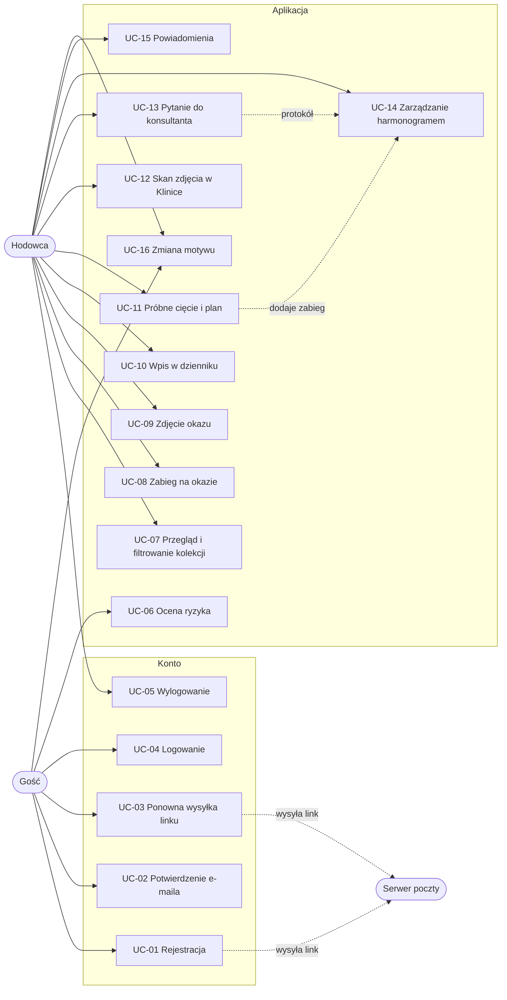

# Przypadki użycia

Aktorzy i wymagania opisuje [specification.md](specification.md), historyjki [user-stories.md](user-stories.md).

## Diagram

## UC-01 Rejestracja konta

| | |
| --- | --- |
| Aktor | Gość |
| Historyjki | US-01 |
| Warunki początkowe | Gość nie jest zalogowany (zalogowany trafia do kolekcji). Baza danych działa. |
| Warunki końcowe | Konto istnieje w bazie jako niepotwierdzone; link aktywacyjny wysłany na podany adres. |

Przebieg główny:
1. Gość otwiera `/register`.
2. System pokazuje formularz rejestracji.
3. Gość wpisuje login, imię, e-mail, hasło i jego powtórzenie, wybiera poziom doświadczenia i (opcjonalnie) gatunki, zaznacza zgodę i wysyła formularz.
4. System sprawdza token CSRF i poprawność wszystkich pól (FR-01, FR-02).
5. System sprawdza, czy login i e-mail są wolne.
6. System zapisuje konto ze skrótem hasła Argon2id i wybranymi gatunkami w jednej transakcji.
7. System zapisuje skrót nowego tokenu i wysyła wiadomość z linkiem aktywacyjnym (UC-02).
8. System przekierowuje na `/verify-email` ze stanem „Sprawdź skrzynkę” i podanym adresem.

Scenariusze alternatywne:
- 4a. Pole niepoprawne (np. hasła różne, login z polskimi znakami): system zwraca formularz (422) z listą błędów na górze, oznaczonymi polami i zachowanymi danymi bez haseł; powrót do kroku 3.
- 5a. Login lub e-mail zajęty albo login zarezerwowany: błąd przy właściwym polu; powrót do kroku 3.
- 6a. Ktoś zajął login lub e-mail między krokiem 5 a 6: unikalny indeks w bazie odrzuca zapis, system pokazuje błąd przy właściwym polu; powrót do kroku 3.
- 7a. Serwer poczty nie odpowiada: konto zostaje, link jest usuwany, system przechodzi do kroku 8 z komunikatem o błędzie wysyłki; gość może użyć UC-03.

Wyjątki:
- Brak lub zły token CSRF: odpowiedź 419.
- Baza danych nie działa: strona 503.

## UC-02 Potwierdzenie adresu e-mail

| | |
| --- | --- |
| Aktor | Gość (właściciel skrzynki) |
| Historyjki | US-02 |
| Warunki początkowe | Konto niepotwierdzone, wiadomość z linkiem w skrzynce. |
| Warunki końcowe | Adres potwierdzony (`email_verified_at`), linki konta usunięte. |

Przebieg główny:
1. Użytkownik otwiera wiadomość i klika „Potwierdź adres e-mail”.
2. System liczy skrót SHA-256 tokenu z adresu i znajduje pasujący link.
3. System sprawdza, że link nie wygasł.
4. System oznacza adres jako potwierdzony i usuwa linki konta.
5. System przekierowuje na `/login?login=…` z komunikatem „Adres e-mail potwierdzony”.

Scenariusze alternatywne:
- 2a. Token w złym formacie, nieznany albo już użyty: strona „Link nie działa” (404) z formularzem ponownej wysyłki.
- 3a. Link wygasł (ponad 24 h): strona „Link wygasł” (410) z przyciskiem wysłania nowego linku na adres konta (UC-03).

## UC-03 Ponowna wysyłka linku aktywacyjnego

| | |
| --- | --- |
| Aktor | Gość |
| Historyjki | US-03 |
| Warunki początkowe | Brak. |
| Warunki końcowe | Gdy konto istnieje, jest niepotwierdzone i minęła minuta od ostatniej wysyłki: nowy link wysłany, poprzedni nieważny. |

Przebieg główny:
1. Gość wybiera ponowną wysyłkę: na stronie „Sprawdź skrzynkę”, „Link wygasł”, „Link nie działa” albo po nieudanym logowaniu na niepotwierdzone konto.
2. Gość podaje login lub e-mail (albo jest on wstawiony automatycznie) i wysyła formularz.
3. System sprawdza token CSRF i szuka konta.
4. System tworzy nowy link (usuwając poprzednie) i wysyła wiadomość.
5. System pokazuje komunikat „Jeśli konto czeka na potwierdzenie, wysłaliśmy nowy link”.

Scenariusze alternatywne:
- 3a. Konto nie istnieje, jest już potwierdzone albo od ostatniej wysyłki nie minęła minuta: system nic nie wysyła i przechodzi do kroku 5 z tym samym komunikatem.
- 4a. Serwer poczty nie odpowiada: komunikat o błędzie, link nie zostaje zapisany.

## UC-04 Logowanie

| | |
| --- | --- |
| Aktor | Gość |
| Historyjki | US-04 |
| Warunki początkowe | Gość ma konto. |
| Warunki końcowe | Sesja zalogowanego użytkownika z nowym identyfikatorem; zapisany czas logowania. |

Przebieg główny:
1. Gość otwiera `/login` i podaje login lub e-mail oraz hasło.
2. System sprawdza token CSRF i szuka konta (bez względu na wielkość liter).
3. System weryfikuje hasło.
4. System sprawdza, że adres e-mail jest potwierdzony.
5. System zapisuje czas logowania (i przelicza starszy skrót hasła na Argon2id), zmienia identyfikator sesji i przekierowuje do `/collection`.

Scenariusze alternatywne:
- 1a. Puste pole: komunikat „Podaj login lub adres e-mail oraz hasło” (401).
- 2a / 3a. Konto nie istnieje lub hasło błędne: komunikat „Nieprawidłowy login lub hasło” (401); czas odpowiedzi nie zależy od istnienia konta.
- 4a. Adres niepotwierdzony: komunikat „Najpierw potwierdź adres e-mail” i przycisk ponownej wysyłki (UC-03); brak sesji.

## UC-05 Wylogowanie

| | |
| --- | --- |
| Aktor | Hodowca |
| Warunki końcowe | Sesja wyczyszczona; strony aplikacji przekierowują na `/login`. |

Przebieg główny:
1. Hodowca otwiera menu konta i wybiera „Wyloguj się”.
2. System sprawdza token CSRF, czyści sesję, zmienia jej identyfikator i przekierowuje na stronę główną.

## UC-06 Szybka ocena ryzyka

| | |
| --- | --- |
| Aktor | Gość lub hodowca |
| Historyjki | US-08 |

Przebieg główny:
1. Użytkownik otwiera stronę główną i przewija do oceny ryzyka.
2. Użytkownik wybiera gatunek, podłoże, częstotliwość podlewania i ekspozycję na światło.
3. Przeglądarka po każdej zmianie przelicza wskaźnik ryzyka i pokazuje poziom, główne czynniki i zalecaną akcję.
4. Użytkownik przechodzi do Kliniki, aby opisać objawy.

Scenariusze alternatywne:
- 3a. JavaScript wyłączony: widoczny jest wynik domyślny, a formularz prowadzi do Kliniki.

## UC-07 Przegląd i filtrowanie kolekcji

| | |
| --- | --- |
| Aktor | Hodowca |
| Historyjki | US-10, US-11 |

Przebieg główny:
1. Hodowca otwiera `/collection`.
2. System pokazuje drzewka wymagające zabiegu (najpilniejsze wyróżnione), listę wszystkich okazów, najbliższe zabiegi i dziennik.
3. Hodowca wybiera filtr (iglaste, liściaste, wymagające uwagi) albo wpisuje nazwę.
4. System filtruje listę (z JS bez przeładowania, bez JS przez parametry adresu).
5. Hodowca otwiera kartę okazu `/collection/{id}`.

Scenariusze alternatywne:
- 4a. Brak wyników: komunikat „Żaden okaz nie pasuje” i powrót do pełnej listy.
- 5a. Nieznany identyfikator okazu: strona 404.

## UC-08 Zabieg na okazie

| | |
| --- | --- |
| Aktor | Hodowca |
| Historyjki | US-12 |
| Warunki końcowe | Stan drzewka, podsumowanie kolekcji, zadania i powiadomienia zaktualizowane. |

Przebieg główny:
1. Hodowca wybiera „Zapisz podlanie” albo „Zapisz korektę drutu” w kolekcji lub na karcie okazu.
2. System sprawdza token CSRF i rodzaj zabiegu, zapisuje go w stanie użytkownika.
3. System zwraca nową wilgotność, stan i podsumowanie; strona aktualizuje się bez przeładowania i pokazuje komunikat.

Scenariusze alternatywne:
- 2a. Nieznany okaz lub rodzaj zabiegu: komunikat błędu (422).
- 3a. JavaScript wyłączony: przekierowanie z komunikatem flash.

## UC-09 Dodanie i usunięcie zdjęcia okazu

| | |
| --- | --- |
| Aktor | Hodowca |
| Historyjki | US-14 |

Przebieg główny:
1. Hodowca na karcie okazu wybiera „Dodaj zdjęcie” i wskazuje plik.
2. Przeglądarka zmniejsza duże zdjęcie i wysyła je.
3. System sprawdza typ po zawartości, rozmiar i wymiary, zapisuje plik pod losową nazwą w `storage/uploads/{id}/`.
4. Zdjęcie pojawia się w galerii karty.
5. Hodowca może usunąć zdjęcie; system usuwa wpis i plik.

Scenariusze alternatywne:
- 3a. Zły typ, za duży plik lub wymiary: komunikat błędu, nic nie jest zapisywane.
- 3b. Limit 60 zdjęć: komunikat „Osiągnięto limit zdjęć”.
- Inny użytkownik próbuje otworzyć `/media/{name}`: 404.

## UC-10 Wpis w dzienniku

| | |
| --- | --- |
| Aktor | Hodowca |
| Historyjki | US-13 |

Przebieg główny:
1. Hodowca wpisuje notatkę w panelu „Dziennik obserwacji” i zapisuje.
2. System sprawdza długość (3–500 znaków) i dopisuje wpis (przechowuje najnowsze 200).
3. Wpis pojawia się na górze dziennika.

Scenariusze alternatywne:
- 2a. Za krótki lub za długi wpis: komunikat błędu (422).

## UC-11 Próbne cięcie i plan w harmonogramie

| | |
| --- | --- |
| Aktor | Hodowca |
| Historyjki | US-15–US-18 |

Przebieg główny:
1. Hodowca otwiera `/studio` i wybiera styl oraz gatunek.
2. W sekcji „Próbne cięcie” zaznacza gałęzie do usunięcia (myszą lub klawiszem Enter).
3. Przeglądarka przelicza pozostałe ulistnienie i przesunięcie środka masy korony oraz pokazuje wskazówkę.
4. Hodowca wybiera „Dodaj plan cięcia do harmonogramu”.
5. System zapisuje zabieg typu „cięcie i formowanie” na dziś i pokazuje komunikat.

Scenariusze alternatywne:
- 3a. Usunięto ponad 1/3 ulistnienia: ostrzeżenie o rozłożeniu cięć na dwa sezony.
- 4a. Brak zaznaczonych gałęzi: przycisk nieaktywny.
- 5a. Limit 100 własnych zabiegów: komunikat błędu.

## UC-12 Skan zdjęcia w Klinice

| | |
| --- | --- |
| Aktor | Hodowca |
| Historyjki | US-19 |

Przebieg główny:
1. Hodowca otwiera `/clinic`, wybiera część drzewa i wskazuje zdjęcie.
2. Przeglądarka pokazuje animację skanowania i analizuje barwę pikseli (zieleń, żółć, brąz).
3. System pokazuje orientacyjny indeks barwy i poziom.
4. Hodowca zapisuje skan; system zapisuje zdjęcie i wynik w historii.

Scenariusze alternatywne:
- 2a. Na zdjęciu brak roślinności: prośba o zbliżenie na liście lub igły.
- 4a. Historia ma już 30 skanów: najstarszy skan i jego zdjęcie są usuwane, nowy zostaje zapisany.
- Ograniczony ruch (`prefers-reduced-motion`): bez animacji skanowania.

## UC-13 Pytanie do konsultanta i protokół ratunkowy

| | |
| --- | --- |
| Aktor | Hodowca |
| Historyjki | US-20, US-21 |

Przebieg główny:
1. Hodowca wpisuje pytanie (3–300 znaków) albo wybiera gotowe.
2. System dopasowuje słowa kluczowe do bazy wiedzy i zwraca odpowiedź z godziną.
3. Odpowiedź pojawia się w rozmowie.
4. Opcjonalnie hodowca wybiera „Dodaj 3 kroki do harmonogramu”; system zapisuje kroki protokołu jako własne zabiegi na dziś.

Scenariusze alternatywne:
- 1a. Pytanie za krótkie lub za długie: komunikat błędu (422).
- 2a. Brak dopasowania: konsultant informuje o tym i podsuwa tematy.

## UC-14 Zarządzanie harmonogramem

| | |
| --- | --- |
| Aktor | Hodowca |
| Historyjki | US-22, US-23 |

Przebieg główny:
1. Hodowca otwiera `/schedule`; system pokazuje bieżący tydzień, porę sekki, zadania na dziś i okna sezonowe.
2. Hodowca przechodzi do innego dnia lub tygodnia (strzałki, gest, „Dziś”, parametr `?date=`).
3. Hodowca odhacza wykonane zadanie; system zapisuje stan.
4. Hodowca dodaje własny zabieg (nazwa, opis, godzina, rodzaj).
5. Hodowca usuwa własny zabieg.

Scenariusze alternatywne:
- 1a. Dzień bez zadań: informacja i przycisk dodania zabiegu.
- 4a. Niepoprawne dane lub limit 100 zabiegów: komunikat błędu (422).
- 3a / 5a. Nieznane zadanie: komunikat błędu (404).

## UC-15 Powiadomienia

| | |
| --- | --- |
| Aktor | Hodowca |
| Historyjki | US-24 |

Przebieg główny:
1. Hodowca widzi licznik nieprzeczytanych na dzwonku w górnym pasku.
2. Hodowca otwiera panel; system pobiera aktualną listę (`GET /notifications`).
3. Hodowca oznacza jedno powiadomienie albo wszystkie jako przeczytane; licznik się zmniejsza.
4. Hodowca zamyka panel klawiszem Escape lub kliknięciem poza nim.

## UC-16 Zmiana motywu

| | |
| --- | --- |
| Aktor | Gość lub hodowca |
| Historyjki | US-07 |

Przebieg główny:
1. Strona ładuje się w motywie systemu (brak ciasteczka `theme`).
2. Użytkownik klika przełącznik motywu.
3. Strona zmienia motyw bez przeładowania i zapisuje wybór (`POST /theme`) w ciasteczku na rok.
4. Ponowne kliknięcie przywraca motyw systemu i usuwa ciasteczko.

Scenariusze alternatywne:
- 3a. JavaScript wyłączony: formularz wysyła wybór i wraca na tę samą stronę.
- 3b. Zapis się nie powiódł: motyw wraca do poprzedniego, komunikat błędu.
